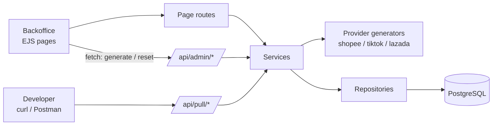
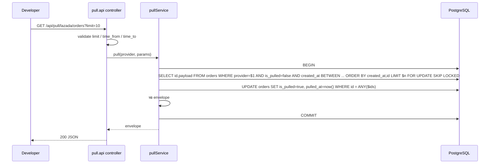

# Design: Provider Order Pulling Simulator

เอกสารนี้ออกแบบตาม `requirements.md` ยังไม่มีการ implement

## 1. สถาปัตยกรรม

แอปเดียว (Node.js + Express) ให้บริการ 3 ส่วนใน process เดียว ได้แก่ หน้า Backoffice (EJS, server-side rendered), Admin API และ Pulling API โดยทุกส่วนเรียกชั้น service เดียวกัน เพื่อไม่ให้ logic ซ้ำ (Requirement 6.4)



### Tech และเวอร์ชัน

| ส่วน | เลือกใช้ | เหตุผล |
|---|---|---|
| Runtime | Node.js 22 LTS (`node:22-alpine`) | LTS, image เล็ก |
| Web | `express` | ตามที่กำหนด |
| View | `ejs` + partial layout | ตามที่กำหนด |
| DB driver | `pg` (Pool) | เขียน SQL ตรง ควบคุม `FOR UPDATE SKIP LOCKED` ได้ ไม่ต้องใช้ ORM |
| DB | PostgreSQL 16 (`postgres:16-alpine`) | JSONB, row locking |
| Migration | ไฟล์ SQL + runner เล็ก ๆ ในโปรเจค | ไม่เพิ่ม dependency |
| Validation | ฟังก์ชัน validate เขียนเอง | อินพุตมีไม่กี่ตัว ไม่ต้องเพิ่ม library |

Dependency รวมมี 3 ตัว: `express`, `ejs`, `pg`

## 2. โครงสร้างโปรเจค

```
provider-order-pulling/
├── docker-compose.yml
├── Dockerfile
├── .env.example
├── .dockerignore
├── README.md
├── package.json
├── data-example/                  # ตัวอย่างเดิม (ไม่แก้ไข)
├── db/
│   └── migrations/
│       └── 001_init.sql
└── src/
    ├── server.js                  # bootstrap: รอ DB -> migrate -> seed -> listen
    ├── app.js                     # สร้าง express app, mount routes, error handler
    ├── config.js                  # อ่าน env
    ├── db/
    │   ├── pool.js
    │   ├── migrate.js
    │   └── seed/
    │       ├── index.js           # seed แบบ idempotent
    │       └── products.js        # ข้อมูลสินค้า 36 รายการ
    ├── routes/
    │   ├── pages.js               # /products /orders ...
    │   ├── admin.api.js           # /api/admin/*
    │   └── pull.api.js            # /api/pull/*
    ├── controllers/               # แปลง req/res <-> service
    ├── services/
    │   ├── productService.js
    │   ├── orderService.js        # generate, list, detail, reset
    │   └── pullService.js         # pull + stamp
    ├── repositories/
    │   ├── productRepo.js
    │   └── orderRepo.js
    ├── generators/
    │   ├── index.js               # registry: provider -> generator
    │   ├── common.js              # random helpers, ฟอร์แมตเวลา, ราคา
    │   ├── shopee.js
    │   ├── tiktok.js
    │   ├── lazada.js
    │   └── templates/             # สำเนาโครงสร้างจาก data-example
    │       ├── shopee.order.json
    │       ├── shopee.item.json
    │       ├── tiktok.order.json
    │       ├── tiktok.line-item.json
    │       ├── lazada.order.json       # จาก lazada-data.json (หัวออร์เดอร์)
    │       ├── lazada.item.json        # จาก lazada-order-item.json (รายการสินค้า)
    ├── envelopes.js               # ห่อ response ตาม Provider
    ├── validators.js
    ├── views/
    │   ├── layout/ (header.ejs, sidebar.ejs, footer.ejs)
    │   ├── products.ejs
    │   ├── order-new.ejs
    │   ├── orders.ejs
    │   ├── order-detail.ejs
    │   └── error.ejs
    └── public/
        ├── css/app.css
        └── js/ (order-new.js, orders.js)
```

## 3. Database Schema (`db/migrations/001_init.sql`)

```sql
CREATE TABLE schema_migrations (
  name       text PRIMARY KEY,
  applied_at timestamptz NOT NULL DEFAULT now()
);

CREATE TABLE products (
  id             serial PRIMARY KEY,
  sku            text           NOT NULL UNIQUE,
  name           text           NOT NULL,
  variation_name text           NOT NULL,
  category       text           NOT NULL,
  original_price numeric(12,2)  NOT NULL CHECK (original_price > 0),
  sale_price     numeric(12,2)  NOT NULL CHECK (sale_price > 0),
  weight_kg      numeric(8,3)   NOT NULL,
  image_url      text           NOT NULL,
  product_url    text           NOT NULL,
  warehouse_code text           NOT NULL,
  item_id        bigint         NOT NULL UNIQUE,
  model_id       bigint         NOT NULL UNIQUE,
  created_at     timestamptz    NOT NULL DEFAULT now()
);

CREATE TABLE orders (
  id                bigserial PRIMARY KEY,
  provider          text          NOT NULL CHECK (provider IN ('shopee','tiktok','lazada')),
  external_order_id text          NOT NULL,
  currency          text          NOT NULL,
  total_amount      numeric(14,2) NOT NULL,
  item_count        int           NOT NULL CHECK (item_count BETWEEN 1 AND 10),
  payload           jsonb         NOT NULL,
  is_pulled         boolean       NOT NULL DEFAULT false,
  pulled_at         timestamptz,
  created_at        timestamptz   NOT NULL DEFAULT now(),
  UNIQUE (provider, external_order_id)
);

-- รองรับ query ของ Pulling API (provider + is_pulled + ช่วงเวลา + เรียงตามเวลา)
CREATE INDEX idx_orders_pull ON orders (provider, created_at, id) WHERE is_pulled = false;
CREATE INDEX idx_orders_list ON orders (created_at DESC, id DESC);

CREATE TABLE order_items (
  id         bigserial PRIMARY KEY,
  order_id   bigint        NOT NULL REFERENCES orders(id) ON DELETE CASCADE,
  product_id int           NOT NULL REFERENCES products(id),
  quantity   int           NOT NULL CHECK (quantity > 0),
  unit_price numeric(12,2) NOT NULL,   -- ราคาขาย ณ เวลาสร้าง (หน่วยสกุลเงินของ Provider)
  line_total numeric(14,2) NOT NULL,
  payload    jsonb                      -- Lazada: order item object (Shopee/TikTok: NULL)
);
CREATE INDEX idx_order_items_order ON order_items (order_id);
```

หมายเหตุ

- `orders.payload` เก็บ order object ตามรูปแบบ Provider โดย Shopee/TikTok มีรายการสินค้าซ้อนอยู่ใน object นี้ ส่วน Lazada เก็บเฉพาะ **หัวออร์เดอร์** (`lazada-data.json`) และเก็บ order item (`lazada-order-item.json`) แยกไว้ที่ `order_items.payload` 1 แถวต่อ item เพราะ Lazada มี endpoint แยกสำหรับดึงรายการสินค้า
- `orders.external_order_id` ของ Lazada = `order_id` ในหัวออร์เดอร์ (ใช้เป็น `:orderId` ของ items endpoint) ต้องมี index `(provider, external_order_id)` ซึ่งมีอยู่แล้วจาก UNIQUE constraint
- สถานะการ pulling อยู่ใน `is_pulled` และ `pulled_at` ไม่ปนใน payload (Requirement 5.5.2)
- Partial index (`WHERE is_pulled = false`) ทำให้ query ของ Pulling API เร็วเมื่อออร์เดอร์ที่ถูกดึงแล้วสะสมมาก
- ID ของ Provider อื่น ๆ (TikTok `product_id`/`sku_id`, Lazada `product_id`/`sku_id`) derive จาก `item_id` และ `model_id` เช่น `String(item_id)` จึงไม่ต้องมีคอลัมน์เพิ่ม

## 4. Product Seed

- `seed/products.js` เก็บสินค้า 36 รายการ ใน 6 หมวด (ความงาม, เครื่องใช้ไฟฟ้า, แฟชั่น, ของใช้ในบ้าน, อาหารเสริม, อุปกรณ์เสริมมือถือ) โดยหมวดความงามอ้างอิงสินค้าจากตัวอย่าง Shopee
- ราคาเก็บเป็น "หน่วยฐาน" (ค่าใกล้เคียง USD) แล้วแต่ละ Provider แปลงเป็นสกุลเงินตัวอย่างตอนสร้างออร์เดอร์ (ดูหัวข้อ 6.1)
- Seed ทำงานใน transaction เดียว: `SELECT count(*) FROM products` ถ้า > 0 ข้าม มิฉะนั้น insert ทั้งหมด จึง idempotent (Requirement 1.2) และกันการ insert ซ้ำเมื่อสอง instance start พร้อมกันด้วย `pg_advisory_xact_lock`

## 5. API Contract

### 5.1 Admin API (`/api/admin`)

ตอบ JSON เสมอ รูปแบบ error: `{ "error": { "code": "VALIDATION_ERROR", "message": "..." } }`

| Method | Path | Query/Body | Response |
|---|---|---|---|
| GET | `/products` | `page`=1, `pageSize`=20 (max 100), `q` | `{ data: [...], page, pageSize, total }` |
| POST | `/orders/generate` | `{ provider: "shopee"\|"tiktok"\|"lazada", productCount: 1..10 }` | 201 `{ data: { id, provider, externalOrderId, itemCount, totalAmount, currency, createdAt } }` |
| GET | `/orders` | `provider`, `pulled` (`true`/`false`), `page`, `pageSize` | `{ data: [...], page, pageSize, total }` |
| GET | `/orders/:id` | | `{ data: { ...meta, items: [...], payload } }` / 404 (Lazada: `payload` = หัวออร์เดอร์ และ `items[i].payload` = order item) |
| POST | `/orders/:id/reset-pulled` | | `{ data: { id, isPulled: false } }` / 404 |
| POST | `/orders/reset-pulled` | optional `?provider=` | `{ data: { resetCount } }` |

Validation: `productCount` ต้องเป็นจำนวนเต็ม 1-10 และไม่เกินจำนวนสินค้าใน DB, `provider` ต้องอยู่ใน 3 ค่า, `page` / `pageSize` เป็นจำนวนเต็มบวก ผิดเงื่อนไขตอบ 400

### 5.2 Pulling API (`/api/pull`)

| Method | Path |
|---|---|
| GET | `/api/pull/shopee/orders` |
| GET | `/api/pull/tiktok/orders` |
| GET | `/api/pull/lazada/orders` |
| GET | `/api/pull/lazada/orders/:orderId/items` (Lazada เท่านั้น) |

Query parameters (optional ทั้งหมด)

| ชื่อ | ความหมาย | ค่า |
|---|---|---|
| `limit` | จำนวนออร์เดอร์สูงสุดต่อครั้ง | จำนวนเต็ม 1-50, default 10 |
| `time_from` | เวลาสร้างออร์เดอร์ตั้งแต่ (รวม) | Unix seconds หรือ ISO 8601 |
| `time_to` | เวลาสร้างออร์เดอร์ถึง (รวม) | Unix seconds หรือ ISO 8601 |

การแปลงค่าเวลา: ถ้าเป็นตัวเลขล้วน 10 หลัก (หรือจำนวนเต็มทั่วไป) ถือเป็น Unix seconds มิฉะนั้นลอง `new Date(value)` ถ้า `NaN` ตอบ 400 และถ้า `time_from > time_to` ตอบ 400 ตัวเลขล้วนที่ไม่ใช่จำนวนเต็มบวกถือว่าผิดรูปแบบ

สำหรับ Lazada list endpoint รับ `created_after` / `created_before` เป็นชื่อแทนของ `time_from` / `time_to` (ตรงกับ GetOrders) ถ้าส่งทั้งสองชื่อของขอบเดียวกันตอบ 400

Response สำเร็จ (200) ใช้ envelope ตามตัวอย่างของ Provider (ดู 6.4) และเมื่อไม่มีออร์เดอร์ก็ตอบ 200 พร้อมลิสต์ว่าง Error ตอบ `{ "error": "BAD_REQUEST", "message": "..." }` พร้อม status 400

ตัวอย่าง

```bash
curl "http://localhost:3002/api/pull/shopee/orders?limit=5&time_from=2026-11-17T00:00:00Z"
```

### 5.3 Page routes (EJS)

| Path | หน้า |
|---|---|
| `/` | redirect ไป `/products` |
| `/products` | รายการสินค้า (ค้นหา + pagination) |
| `/orders/new` | ฟอร์มสร้างออร์เดอร์ |
| `/orders` | รายการคำสั่งซื้อ (filter + pagination + ปุ่ม reset) |
| `/orders/:id` | รายละเอียด + raw JSON + ปุ่ม reset |

หน้า list render ฝั่ง server ผ่าน service ตัวเดียวกับ Admin API ส่วนปุ่ม "Gen Order Data" และปุ่ม reset เรียก Admin API ด้วย `fetch` แล้ว reload/ redirect ผ่าน JS ขนาดเล็กใน `public/js`

## 6. Order Generation

### 6.1 หลักการ

- เก็บ **template** ของแต่ละ Provider ใน `generators/templates/*.json` โดยคัดลอกโครงสร้างและค่าตัวอย่างจาก `data-example/` ตรง ๆ (รวม key `" "` ของ TikTok) แล้ว `structuredClone` ทุกครั้งที่สร้าง จากนั้นเขียนทับเฉพาะฟิลด์ที่ขึ้นกับออร์เดอร์ รายชื่อฟิลด์ ชนิด และรูปแบบค่าจึงตรงกับตัวอย่างโดยโครงสร้าง (Requirement 5.5)
- Generator เป็น pure function: `generate({ lines, now }) => { externalOrderId, currency, totalAmount, items, payload }` โดย `items[i]` มี `{ product, quantity, unitPrice, lineTotal, payload? }` (`payload` ใช้เฉพาะ Lazada) และ `lines` คือ `[{ product, quantity }]` ทำให้เพิ่ม Provider ใหม่ได้โดยเพิ่มไฟล์ใน registry (`generators/index.js`)
- การแปลงสกุลเงินใช้ค่าคงที่ใน `common.js` (ราคาฐาน × อัตรา แล้วปัดตามชนิดข้อมูลของ Provider)

| Provider | currency | อัตรา (ต่อ 1 หน่วยฐาน) | รูปแบบราคา |
|---|---|---|---|
| Shopee | VND | 25,000 ปัดเป็นพัน | number (จำนวนเต็ม) |
| TikTok | IDR | 16,000 ปัดเป็นร้อย | string |
| Lazada | SGD | 1.3 ทศนิยม 2 ตำแหน่ง | string `"99.00"` (อยู่ใน order item) |

- จำนวนชิ้นต่อสินค้า (quantity) สุ่ม 1-3
- สินค้าถูกสุ่มโดยไม่ซ้ำ (`ORDER BY random() LIMIT n`) ภายในออร์เดอร์เดียว
- ข้อมูลผู้ซื้อ/ที่อยู่เป็นข้อมูลสมมติจากรายการชื่อ/เบอร์/ที่อยู่ที่เขียนไว้ใน `common.js` และเบอร์/ชื่อใช้รูปแบบ mask เหมือนตัวอย่าง

### 6.2 ฟิลด์ที่เขียนทับ (นอกนั้นคงตามตัวอย่าง)

**Shopee** (`response.order_list[i]`)

- `buyer_user_id`, `buyer_username`, `create_time`, `update_time`, `pay_time`, `pickup_done_time`, `ship_by_date` (Unix seconds, อิงเวลาปัจจุบัน)
- `item_list[]`: สร้างจาก `shopee.item.json` ต่อสินค้า 1 รายการ โดยเขียนทับ `item_id`, `order_item_id` (= `item_id`), `item_name`, `model_id`, `model_name`, `model_sku`, `model_original_price`, `model_discounted_price`, `model_quantity_purchased`, `weight`, `image_info.image_url`
- `total_amount` = ผลรวม (`model_discounted_price` × จำนวน) + `estimated_shipping_fee`
- ไม่มีฟิลด์ id/สถานะของออร์เดอร์ (ตามตัวอย่าง) จึงใช้ `external_order_id` ที่ระบบสร้างภายในเท่านั้นสำหรับ Backoffice

**TikTok** (`data.orders[i]`)

- `id` (18 หลัก, ตัวเลขเป็น string), `user_id`, `create_time`, `update_time`, `paid_time`, ฟิลด์ `*_time` ที่เป็น Unix seconds, `tracking_number`, `buyer_nickname`, `buyer_email`, `recipient_address.name/first_name/last_name/phone_number`
- `line_items[]`: สร้างจาก `tiktok.line-item.json` ต่อสินค้า 1 รายการ เขียนทับ `id`, `sku_id`, `product_id`, `product_name`, `sku_name`, `seller_sku`, `sku_image`, `original_price`, `sale_price` และ `sub_item_info[0]` ที่ชุดฟิลด์ตรงกัน (แต่ละ `line_item` ในตัวอย่างเป็นหนึ่งชิ้น จึงสร้างซ้ำตามจำนวน quantity ได้ ในดีไซน์นี้ให้ 1 line_item ต่อ 1 สินค้า)
- `payment.sub_total`, `payment.original_total_product_price`, `payment.total_amount` คำนวณจากสินค้า ฟิลด์อื่นของ `payment` คงตามตัวอย่าง
- `status` คง `UNPAID` ตามตัวอย่าง

**Lazada** (2 ระดับ)

หัวออร์เดอร์ (`lazada.order.json`, เก็บใน `orders.payload`)

- เขียนทับ `order_id` (ตัวเลข string, ไม่ซ้ำ), `order_number`, `created_at`, `updated_at` (`YYYY-MM-DD HH:mm:ss +0800`), `promised_shipping_times` (`YYYY-MM-DD HH:mm:ss` ไม่มี timezone), `price` (ผลรวม `paid_price` ของ order item), `items_count` (string), `customer_first_name`, `customer_last_name` และชื่อ/เบอร์/ที่อยู่ใน `address_shipping`, `address_billing`, `recipient_info` (ข้อมูลสมมติ)
- ฟิลด์อื่นรวมถึง `statuses: []` คงตามตัวอย่าง

รายการสินค้า (`lazada.item.json`, 1 object ต่อสินค้า เก็บใน `order_items.payload`)

- ทุก item ใช้ค่าร่วมกันของออร์เดอร์ ได้แก่ `order_id` (= `order_id` ของหัวออร์เดอร์), `purchase_order_id`, `purchase_order_number`, `buyer_id`, `created_at`, `updated_at`, `payment_time` (epoch ms string), `package_id`
- แต่ละ item เขียนทับ `order_item_id` (ไม่ซ้ำ), `product_id`, `sku_id`, `sku`, `shop_sku`, `name`, `product_main_image`, `product_detail_url`, `item_price`, `paid_price`, `supply_price`, `tracking_code`
- รูปแบบเวลาคงตามตัวอย่างแต่ละฟิลด์: `created_at` = `YYYY-MM-DD HH:mm:ss +0800`, `sla_time_stamp` = ISO 8601 ที่เวลาปัจจุบัน + SLA, `promised_shipping_time` = `YYYY-MM-DD HH:mm:ss +0800`
- 1 item = 1 ชิ้น (quantity = 1) ส่วน `status` คง `canceled`
- `orders.total_amount` = ผลรวม `paid_price`

### 6.3 ขั้นตอน `orderService.generate(provider, productCount)`

1. validate input
2. สุ่มสินค้า `productCount` รายการ (`productRepo.pickRandom(n)`) ถ้าได้น้อยกว่าที่ขอให้ตอบ 400
3. สุ่ม quantity ต่อสินค้า แล้วเรียก `generators[provider].generate(...)`
4. เปิด transaction: INSERT `orders` + `order_items` (Lazada: บันทึก order item แต่ละตัวลง `order_items.payload`) แล้ว commit ถ้า `UNIQUE (provider, external_order_id)` ชน ให้ generate ID ใหม่แล้วลองซ้ำไม่เกิน 3 ครั้ง
5. คืน summary ให้ controller

### 6.4 Envelope (`envelopes.js`)

| Provider | โครงสร้าง |
|---|---|
| Shopee | `{ error: "", message: "", request_id, response: { order_list: [payload...] } }` |
| TikTok | `{ code: 0, data: { orders: [payload...] }, message: "Success", request_id }` |
| Lazada (list) | `{ code: "0", data: { count, countTotal, orders: [หัวออร์เดอร์...] }, request_id }` ตามรูปแบบ GetOrders (`count` = จำนวนที่คืน, `countTotal` = จำนวนที่ยังไม่ถูกดึงและตรง filter ก่อนเรียก) |
| Lazada (items) | `{ code: "0", data: [order item...], request_id }` |

`request_id` สร้างใหม่ทุกครั้ง (32 ตัว hex สำหรับ Shopee, 26-30 หลักตามแต่ละตัวอย่าง) `limit` นับเป็นจำนวนออร์เดอร์ รวมถึง Lazada

## 7. Pulling Flow



- Lazada list ใช้ flow เดียวกัน (คืนเฉพาะ `orders.payload` = หัวออร์เดอร์ ห่อด้วย `data.orders`) และ `countTotal` หาจาก `SELECT count(*)` ด้วยเงื่อนไขเดียวกัน (provider, `is_pulled=false`, ช่วงเวลา) ใน transaction เดียวกันก่อน stamp
- Lazada items: `GET /api/pull/lazada/orders/:orderId/items` ทำ `SELECT o.id FROM orders o WHERE provider='lazada' AND external_order_id=$1` แล้ว `SELECT payload FROM order_items WHERE order_id=$2 ORDER BY id` ไม่มี transaction เขียนและไม่ stamp ไม่พบออร์เดอร์ตอบ 404 `{ error: "NOT_FOUND", message }`
- `FOR UPDATE SKIP LOCKED` ทำให้ request พร้อมกันได้ออร์เดอร์คนละชุด ไม่ซ้ำและไม่รอกัน (Requirement 5.7)
- Commit เกิดก่อนส่ง response ถ้าเครือข่ายขาดหลัง commit ออร์เดอร์จะถูก stamp แต่ client ไม่ได้รับ ซึ่งเป็นข้อจำกัดของ HTTP ธรรมดา แก้ได้ด้วยปุ่ม/ API reset (NFR 4 ใช้ได้เฉพาะกรณีที่ error เกิดก่อน commit)
- ใช้ `created_at` เป็นเวลาที่ filter ซึ่งเป็นเวลาที่ระบบสร้างออร์เดอร์ ไม่ใช่ `create_time` ใน payload

## 8. Backoffice UI

Layout: sidebar ซ้าย (เมนู สินค้า / สร้างออร์เดอร์ / คำสั่งซื้อ) + พื้นที่เนื้อหา ใช้ CSS ที่เขียนเอง (ไม่พึ่ง CDN เพื่อให้ทำงาน offline ใน Docker local)

- **/products**: ช่องค้นหา, ตาราง (รูป, ชื่อ, SKU, หมวด, ราคาปกติ/ขาย, น้ำหนัก), pagination
- **/orders/new**: dropdown Provider (Shopee/TikTok/Lazada), input จำนวนสินค้า (1-10), ปุ่ม **Gen Order Data** ผลลัพธ์แสดงเป็นการ์ดสรุป (Order ID, Provider, จำนวนสินค้า, ยอดรวม) พร้อมลิงก์ไปรายละเอียด และแสดง error ใต้ฟอร์ม
- **/orders**: filter Provider, filter สถานะ (ทั้งหมด/ยังไม่ถูกดึง/ถูกดึงแล้ว), ตาราง, badge สถานะ, ปุ่ม reset ต่อแถว และปุ่ม "รีเซ็ตทั้งหมด" (confirm ก่อน)
- **/orders/:id**: ข้อมูลหลัก, รายการสินค้า, raw JSON (`<pre>`) ของ payload (Lazada แสดง 2 ส่วน: หัวออร์เดอร์ และรายการสินค้า), ปุ่ม reset
- EJS ใช้ `<%= %>` (escape) ทุกจุด ยกเว้น partial ที่เป็นข้อความคงที่

ข้อความ UI ทั้งหมดเป็นภาษาไทย

## 9. Docker

`Dockerfile`

- base `node:22-alpine`, `npm ci --omit=dev`, รันด้วย user `node` (non-root), `CMD ["node","src/server.js"]`

`docker-compose.yml`

```yaml
services:
  db:
    image: postgres:16-alpine
    environment:
      POSTGRES_USER: ${DB_USER}
      POSTGRES_PASSWORD: ${DB_PASSWORD}
      POSTGRES_DB: ${DB_NAME}
    volumes: [pgdata:/var/lib/postgresql/data]
    healthcheck:
      test: ["CMD-SHELL", "pg_isready -U ${DB_USER} -d ${DB_NAME}"]
      interval: 3s
      timeout: 3s
      retries: 20
  app:
    build: .
    env_file: .env
    environment:
      DB_HOST: db
    depends_on:
      db: { condition: service_healthy }
    ports: ["${APP_PORT:-3002}:3002"]
volumes:
  pgdata:
```

- DB ไม่ publish port ออกเครื่องโดยค่าเริ่มต้น (เปิดได้โดยเพิ่ม mapping เอง)
- `server.js` ลอง connect DB ซ้ำ (retry) แม้จะมี healthcheck เพื่อความทนทาน แล้วรัน migration และ seed ก่อน `listen`

`.env.example`

```
APP_PORT=3002
DB_HOST=localhost
DB_PORT=5432
DB_USER=pulling
DB_PASSWORD=change-me
DB_NAME=provider_pulling
PULL_LIMIT_DEFAULT=10
PULL_LIMIT_MAX=50
ORDER_ITEMS_MAX=10
```

## 10. Error Handling และ Logging

- Middleware error ตัวเดียวท้ายสุด: `/api/*` ตอบ JSON, หน้าเว็บ render `error.ejs`
- error ที่ไม่คาดคิดตอบ 500 โดยไม่เปิดเผย stack ต่อ client และ log stack ลง stdout
- log request แบบบรรทัดเดียว (method, path, status, ms) ด้วย middleware เล็กที่เขียนเอง

## 11. การตรวจสอบ (ไม่มี automated test ตาม requirement)

หลัง implement จะตรวจด้วยมือตาม Definition of Done: `docker compose up`, เปิดหน้า Backoffice, สร้างออร์เดอร์ทั้ง 3 Provider, `curl` Pulling API สองครั้งเพื่อยืนยันว่าครั้งที่สองไม่คืนออร์เดอร์เดิม, ทดสอบ `limit`, `time_from/time_to`, และ reset และเทียบชื่อฟิลด์ของ response กับไฟล์ใน `data-example/` ด้วยสคริปต์ครั้งเดียว

## 12. ประเด็นที่ควรรู้

1. Shopee ตามตัวอย่างไม่มี id หรือ status ของออร์เดอร์ใน payload ดังนั้น Developer ที่ pull จะแยกออร์เดอร์ Shopee ด้วยฟิลด์อื่น เช่น `buyer_user_id` + `create_time` ได้เท่านั้น เป็นผลโดยตรงจากการคงข้อมูลตามตัวอย่าง ถ้าต้องการให้เพิ่ม `order_sn` ภายหลังทำได้โดยแก้ template ไฟล์เดียว
2. ราคาของแต่ละ Provider ถูกแปลงจากราคาฐานด้วยอัตราคงที่ จึงไม่ตรงกับราคาสินค้าที่แสดงในหน้าสินค้า (ซึ่งเป็นราคาฐาน) หน้ารายละเอียดออร์เดอร์จึงแสดงสกุลเงินของ Provider กำกับ
3. Lazada 1 order item = 1 ชิ้น (quantity = 1) เพราะตัวอย่างไม่มีฟิลด์จำนวน ส่วน Shopee กับ TikTok สุ่ม quantity 1-3
4. `lazada-data.json` ตรงกับ GetOrder (ออร์เดอร์เดียว) ส่วน list endpoint ใช้รูปแบบ GetOrders (`data.orders[]`, `count`, `countTotal`) ตามเอกสาร Seller Center ชื่อ `count`/`countTotal` ยังไม่ได้ยืนยันกับหน้า Open Platform โดยตรง
5. `order_id` ใน order item ตัวอย่าง (`31202`) ไม่ตรงกับหัวออร์เดอร์ (`16090`) ระบบสร้างให้ตรงกัน
